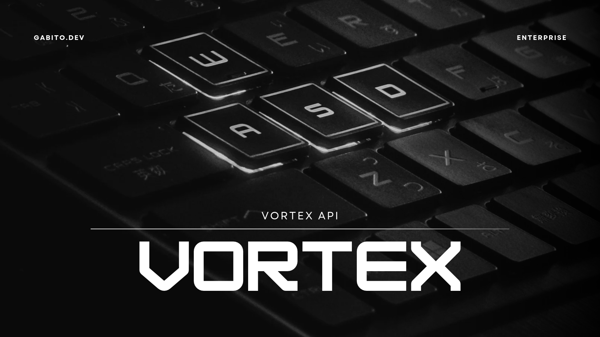

# Vortex API

Hub central de la suite **Vortex** (**ERP, CRM, WMS, POS**), escrito en ASP.NET Core (.NET 10).
Los cuatro sistemas son libres y de código abierto (AGPL-3.0). Cada uno funciona por separado, y
este hub permite usarlos juntos o reemplazar uno por otro sin perder usuarios ni datos.

---

#### Deploya el Proyecto en tu Infra de Azure:

